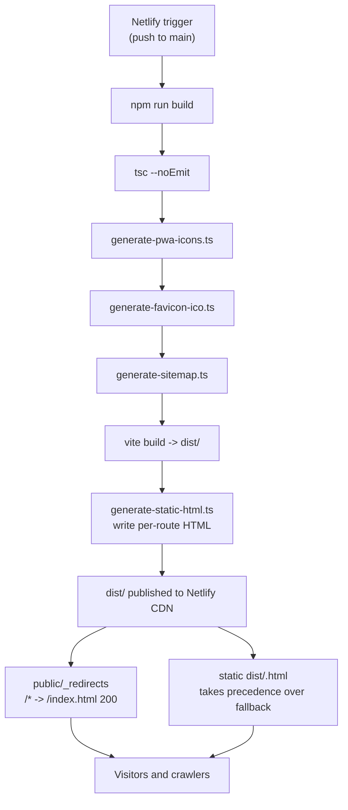

# Deployment

Active contributors: Saksham

360 Flatmates is a client-rendered SPA deployed as static files on a Cloudflare Worker (Netlify before 2026-11-08). There is no server runtime in this repo: the build produces a `dist/` folder, the Worker serves it as static assets from Cloudflare's network, and the SPA fallback turns every unknown path into a client-side navigation. The only "server" the app talks to at runtime is the FastAPI backend at `/api/v1` (and Supabase for auth). This page covers the build command, the publish directory, the SPA fallback and how prerendered files take precedence, the full build pipeline, the environment variables, and the service worker registration. For the prerender engine itself, see [SEO and prerendering](features/seo-prerendering.md). For the installable shell, see [PWA and install](features/pwa-install.md).

## Cloudflare Worker (production host since 2026-11-08)

flatmates.360ghar.com is served by the Cloudflare Worker `360-flatmates-web`, a static-assets Worker with no script. `wrangler.jsonc` is the config:

- `assets.directory` is `./dist`. `html_handling: auto-trailing-slash` serves `dist/<route>.html` at `/<route>` with no slash redirect, so the URL matches the canonical.
- `not_found_handling: single-page-application` serves `index.html` with 200 for client-side routes. This replaces the Netlify `/* /index.html 200` rule, which Cloudflare rejects as an infinite loop; that rule now lives in `netlify.toml` only.
- `routes` attaches the Worker to `flatmates.360ghar.com/*`. The proxied DNS record still points at Netlify, but the route sends every request to the Worker. To roll back to Netlify, delete the route in the Cloudflare dashboard.
- Security headers are in `public/_headers`, which both Cloudflare and Netlify read.
- Build values (`VITE_API_BASE_URL`, `VITE_SUPABASE_URL`, `VITE_SUPABASE_PUBLISHABLE_KEY`) are Workers Builds build variables on the Worker (Settings > Build > Variables and secrets). Do not commit `.env` files.

Build: `npm run build`. Deploy: `npx wrangler deploy`. For a local production deploy, run `CONTEXT=production npm run build` (with production values in your gitignored `.env`) so the build fetches listings, then `npx wrangler deploy`. Workers Builds runs both on every push to `main` and sets `WORKERS_CI_BRANCH=main`, which turns on the build-time listing fetch (`shouldFetchListingData()` in `scripts/lib/listings.ts`).

The Netlify sections below describe the previous host. They stay until the Netlify site is disconnected.

## Netlify configuration

`netlify.toml` is short and authoritative:

```toml
[build]
  command = "npm run build"
  publish = "dist"

[build.environment]
  VITE_API_BASE_URL = "https://api.360ghar.com/api/v1"
```

- **Build command.** `npm run build`. The build needs no browser: the static HTML step is string-based.
- **Publish directory.** `dist`. Vite writes the production bundle here, and the static HTML step writes one `dist/<route>.html` per public route on top.
- **Build environment.** One variable is baked into the build. `VITE_API_BASE_URL` is the production backend URL the bundle is compiled against (Vite inlines `VITE_*` vars at build time, so the served bundle already knows its backend). There is no explicit `PRERENDER_FETCH_DATA` env var: build-time listing fetches gate themselves on Netlify's automatic `CONTEXT` variable (see [SEO and prerendering](features/seo-prerendering.md#build-context-gating-local--preview) — only `CONTEXT=production` fetches listing data; previews and local builds skip the backend entirely).

## SPA fallback and static HTML precedence

On Cloudflare, `not_found_handling: single-page-application` in `wrangler.jsonc` is the SPA fallback. On Netlify, it is this rule in `netlify.toml` (not in `public/_redirects`, which Cloudflare would reject):

```toml
[[redirects]]
  from = "/*"
  to = "/index.html"
  status = 200
```

Both are SPA fallbacks: any path that does not match a real file on disk is served from `dist/index.html` with a 200 status, so React Router can take over. The 200 (not 301 or 302) is what keeps deep links shareable without redirect chains.

Real files on disk take precedence over the fallback. That is the whole point of the static HTML step: `scripts/generate-static-html.ts` writes a real `dist/discover.html`, `dist/cities/bangalore.html`, `dist/discover/123.html`, and so on, so a crawler that fetches `/discover/123` gets the static HTML (with real meta, JSON-LD, and visible content) instead of the empty SPA shell. See [SEO and prerendering](features/seo-prerendering.md) for the route inventory and the generation mechanics.

## The build pipeline

`npm run build` expands (in `package.json`) to a six-step pipeline. Each step feeds the next, and the static HTML step depends on every prior step having succeeded.

```bash
tsc --noEmit &&
npx tsx scripts/generate-pwa-icons.ts &&
npx tsx scripts/generate-favicon-ico.ts &&
npx tsx scripts/generate-sitemap.ts &&
vite build &&
npx tsx scripts/generate-static-html.ts
```

| Step | Script | Output |
| --- | --- | --- |
| 1 | `tsc --noEmit` | Type-check the whole project. A failure halts the build before any artifacts are produced. |
| 2 | `scripts/generate-pwa-icons.ts` | `public/favicon-192.webp`, `public/favicon-512.webp`, plus maskable variants, all derived from `public/favicon.svg`. |
| 3 | `scripts/generate-favicon-ico.ts` | `public/favicon.ico` (multi-resolution legacy icon). |
| 4 | `scripts/generate-sitemap.ts` | `public/sitemap.xml`, derived from the same route inventory and city/neighborhood catalog the static HTML step uses. |
| 5 | `vite build` | `dist/` with the production bundle, the service worker, and a clean `dist/index.html` shell. |
| 6 | `scripts/generate-static-html.ts` | `dist/<route>.html` files, one per public route, built from the shell as strings. |

The social card (`scripts/generate-og-image.ts`) is manual (`npm run generate:og-image`) and committed.

Steps 2 through 4 write into `public/` so Vite copies them into `dist/` during step 5. The static HTML step runs last because it reads the built `dist/index.html` shell. A listing fetch failure logs a warning and the build continues. A missing `dist/` fails the build. See [SEO and prerendering](features/seo-prerendering.md) for the internals.



## Vite build configuration

`vite.config.ts` configures the production build:

- **Plugins.** `@vitejs/plugin-react` for JSX and Fast Refresh, and `VitePWA` for the service worker and manifest. `VitePWA` runs with `registerType: "autoUpdate"` (silent background updates) and `injectRegister: "auto"` (the plugin injects the registration, so no manual `navigator.serviceWorker.register` call is needed). The `includeAssets` array precaches the favicon set, the OG image, the logo, `robots.txt`, `sitemap.xml`, and `llms.txt`.
- **Build target.** `es2022`. The app uses ESM, native fetch, and modern syntax; `tsconfig.json` targets ES2022 to match.
- **Sourcemaps.** Enabled (`build.sourcemap: true`) for production debugging.
- **Manual chunks.** `vendor` (React, React DOM, React Router), `query` (TanStack), `supabase`, and `map` (Leaflet and React-Leaflet) are split out so route-level code stays small. The JS bundle gzip target is under 200KB (see [Architecture](overview/architecture.md)).
- **Path alias.** `@/` resolves to `src/` via `vite-tsconfig-paths`.
- **Dev proxy.** In dev, `/api` is proxied to the configured backend with a rewrite to `/app/v1`, so the SPA can call relative paths in dev while hitting the real backend.

## Environment variables

Vite only exposes variables prefixed with `VITE_` to the client bundle, and it inlines them at build time. The production build reads them from the Netlify build environment; a local build reads them from `.env`. `src/lib/env.ts` validates the required set with a Zod schema on startup:

| Variable | Required | Purpose |
| --- | --- | --- |
| `VITE_API_BASE_URL` | Yes | FastAPI backend URL, e.g. `https://api.360ghar.com/api/v1`. Baked into the bundle at build time. |
| `VITE_SUPABASE_URL` | Yes | Supabase project URL. |
| `VITE_SUPABASE_PUBLISHABLE_KEY` | Yes | Supabase anon/publishable key. |
| `VITE_VAPID_PUBLIC_KEY` | Optional | VAPID public key for web push (FCM). |
| `VITE_AUTH_REDIRECT_URL` | Optional | Override for the Google/Apple OAuth callback URL. Defaults to `${window.location.origin}/auth/callback`. |
| `PRERENDER_CONCURRENCY` | Optional | Bounded concurrency for the prerender capture (default 4 in the script, 20 in production via `netlify.toml`). Not a `VITE_` var, so it never reaches the client; it is read by `scripts/prerender.ts` directly. |
| `PRERENDER_LISTINGS` | Optional | Set to `0` to skip per-listing prerender pages (for a fast smoke build). |
| `PRERENDER_PORT` | Optional | Override the preview server port the prerender step uses (default 4178). |

`src/entry.tsx` calls `validateEnv()` before mounting the app. If a required variable is missing or invalid, it renders a configuration-error screen instead of a blank page, so a misconfigured deploy fails loudly rather than silently shipping a broken app. See [Configuration](reference/configuration.md) for the full variable reference and [Security](security.md) for why only `VITE_`-prefixed vars reach the client.

## Service worker registration

The service worker is registered by `VitePWA` via `injectRegister: "auto"`, which injects the registration call into the bundle at build time. There is no manual `navigator.serviceWorker.register` call in app code. The worker precaches the bundle and the `includeAssets` list, so the installed app has the shell and the static assets offline. On a new deploy, `registerType: "autoUpdate"` fetches the new worker in the background and activates on the next navigation, so users always see the latest version without a "new version available" prompt. The push notification path (`src/lib/push/fcm.ts`) waits for `navigator.serviceWorker.ready` before subscribing, so FCM only runs once the worker is active. See [PWA and install](features/pwa-install.md) for the manifest, install banner, and iOS Safari guide.

## Related pages

- [SEO and prerendering](features/seo-prerendering.md) for the prerender engine and route inventory.
- [PWA and install](features/pwa-install.md) for the service worker, manifest, and install flow.
- [Getting started](overview/getting-started.md) for the local build commands and dev server proxy.
- [Configuration](reference/configuration.md) for the full environment variable reference.

## Key source files

| File | Role |
| --- | --- |
| `netlify.toml` | Build command, publish directory, build environment variables |
| `public/_redirects` | SPA fallback: `/* /index.html 200` |
| `vite.config.ts` | Vite + `VitePWA` + `vite-tsconfig-paths` config, manual chunks, dev proxy |
| `package.json` | The `build` script that chains the seven-step pipeline |
| `scripts/prerender.ts` | Post-build prerender step: serve `dist/`, capture routes with Chromium, write `dist/<route>.html` |
| `scripts/generate-pwa-icons.ts` | Standard and maskable PWA icons from `public/favicon.svg` |
| `scripts/generate-og-image.ts` | Social preview card and logo |
| `scripts/generate-favicon-ico.ts` | Legacy multi-resolution `.ico` |
| `scripts/generate-sitemap.ts` | `sitemap.xml` from the route inventory and city/neighborhood catalog |
| `src/entry.tsx` | Validates env before mount, renders the configuration-error screen on failure, mounts `<App />` |
| `src/lib/env.ts` | Zod-validated environment variable accessor (`getEnv`, `validateEnv`) |
