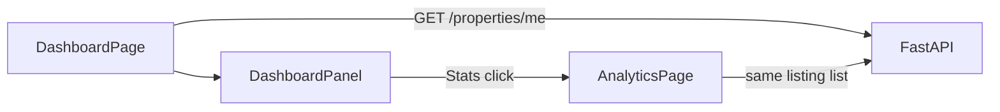

# Dashboard and analytics

Active contributors: Saksham

Once a room poster has listings, they need to see how those listings do. 360 Flatmates gives them two surfaces: a dashboard with lifetime totals, and a per-listing page. The backend has no dashboard or analytics route for a room poster, so both surfaces read the counters that each listing already carries (`view_count`, `like_count`, `interest_count`) from `GET /properties/me`.

## Two surfaces, one source

| Route | File | Source | Purpose |
| --- | --- | --- | --- |
| `/dashboard` | `src/features/hosting/pages/DashboardPage.tsx` | `GET /properties/me`, every page | Lifetime totals across all the user's listings |
| `/dashboard/analytics?propertyId=` | `src/features/hosting/pages/AnalyticsPage.tsx` | the same listing list | Counters for one listing |

The dashboard is the room poster's landing view. The analytics page opens from the "Stats" action on a dashboard row, which goes to `/dashboard/analytics?propertyId={id}`.

## The dashboard

`useDashboardStats()` (`src/features/hosting/hooks/useDashboard.ts`) reads the owner's listings and derives a `RoomPosterDashboard` from them. The owner state of each listing is `listing_preferences.moderation_status` (`live`, `pending_review`, `paused`, `rejected`). `DashboardPage` maps the result into three metric cards and one row per listing for `DashboardPanel`.

| Metric | Source | Helper |
| --- | --- | --- |
| Active Listings | listings that are `live` | `${pending_review} pending review` when more than zero |
| Views | sum of `view_count` | |
| Likes | sum of `like_count` | |

Numbers use `Intl.NumberFormat("en-IN")`, so they render with Indian digit grouping (for example 1,00,000). The cards show no trend arrow, because the API gives no previous-period value.

### The per-listing table

`DashboardPanel` (`src/features/hosting/components/DashboardPanel.tsx`) renders a table on desktop and stacked cards on mobile. Each row shows the title, views, likes, chats (`interest_count`) and the listing state as a tonal `Badge` (published, in review, paused, rejected). Two row actions go to other pages:

| Action | Navigation |
| --- | --- |
| Stats | `/dashboard/analytics?propertyId={id}` |
| Edit | `/my-listings/{id}/edit` |

### Async states

Loading renders `statCard` skeletons plus a table skeleton. Error renders an inline `ErrorState` with retry inside a card, never a full-page error. Empty renders a "No listings yet" card with a "Post a listing" action.

## The analytics page

`AnalyticsPage` reads `propertyId` from the URL, calls `useListingAnalytics(propertyId)` and renders three stat cards: Views, Likes and Chats started. The counters are lifetime values. The page has no period selector, no unique-view count and no daily series, because the backend has no analytics route.

If `propertyId` is missing, zero or `NaN`, the page shows an `EmptyState` titled "Pick a listing first".

## Hooks and query keys

Both authenticated hooks live in `src/features/hosting/hooks/useDashboard.ts` and read `myPropertiesOptions` (`["properties", "mine"]`):

| Hook | Query key | Source | Enabled |
| --- | --- | --- | --- |
| `useDashboardStats()` | `["properties", "mine"]` | `GET /properties/me` | always |
| `useListingAnalytics(propertyId)` | `["properties", "mine"]` with `select` | `GET /properties/me` | `propertyId > 0` |

Every listing mutation invalidates `["properties", "mine"]`, so the dashboard refreshes after a create, edit, pause, resume or delete. See [Listing management](listing-management.md).

## Cross-references

- [Listing management](listing-management.md) for the post, edit, pause, resume and delete flows that feed these numbers.
- [Profile and onboarding](profile-onboarding.md) for room poster mode selection.
- [Listing and property model](../primitives/listing-property.md) for the `RoomPosterDashboard` and `ListingAnalytics` types.

## Key source files

| File | Purpose |
| --- | --- |
| `src/features/hosting/pages/DashboardPage.tsx` | Dashboard overview, maps API data to metrics and rows |
| `src/features/hosting/pages/AnalyticsPage.tsx` | Per-listing lifetime counters |
| `src/features/hosting/components/DashboardPanel.tsx` | Metric cards, desktop table, mobile cards, row actions |
| `src/features/hosting/hooks/useDashboard.ts` | `useDashboardStats`, `useListingAnalytics` |
| `src/features/hosting/components/StatCard.tsx` | Reusable stat card (icon and no-icon variants) |
| `src/lib/api/property.types.ts` | `RoomPosterDashboard` and `ListingAnalytics` types |
